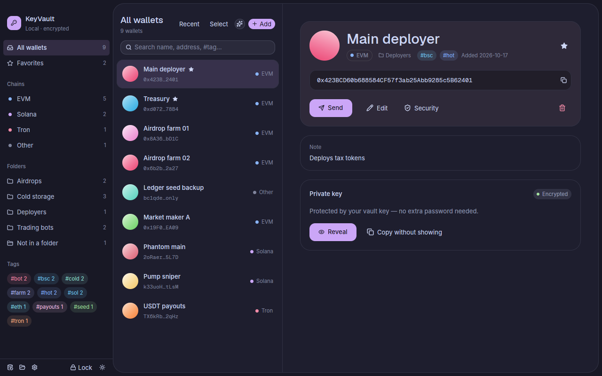
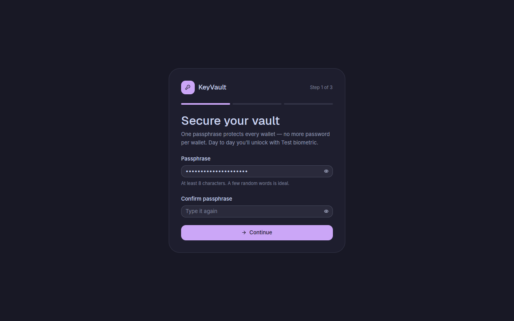
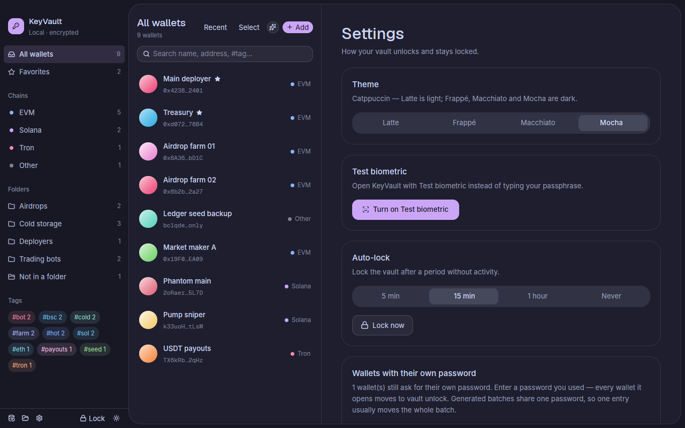
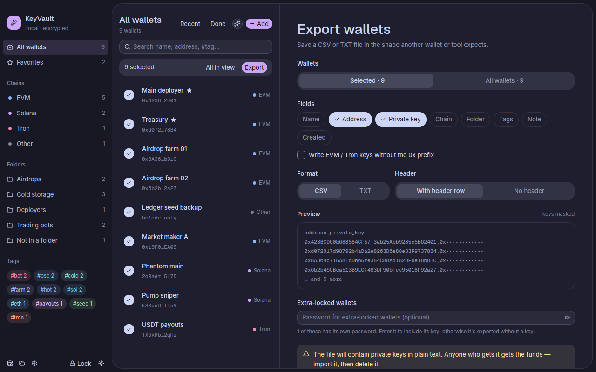
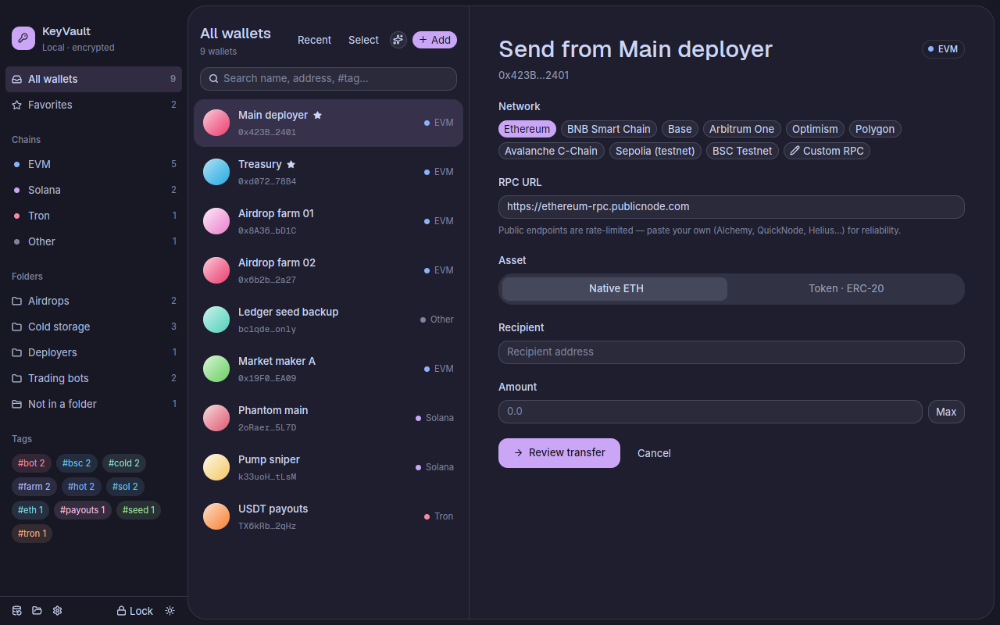
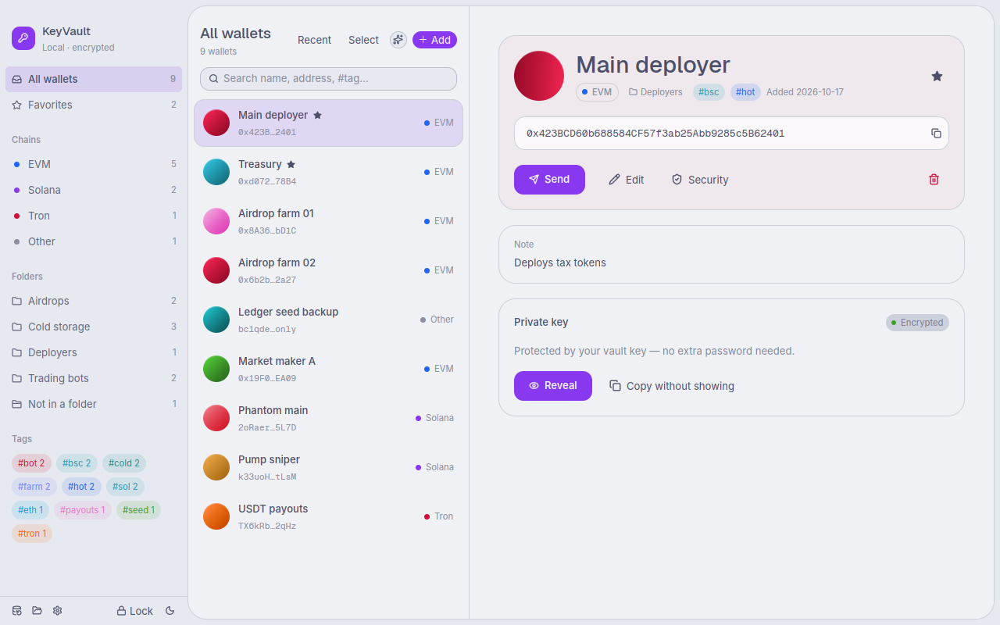

# KeyVault

A desktop vault for **many wallet private keys**, built with Rust and [GPUI](https://gpui-kit.com).
Unlock once — with **Touch ID / Windows Hello** or a passphrase — to manage hundreds of wallets.
Organise them with folders, tags and favorites, generate fresh wallets in bulk, send native coins and
tokens on EVM chains and Solana, and export any selection to CSV or TXT. Everything runs locally.

## Unlocking

- **One vault key.** A random 256-bit key encrypts every wallet (XChaCha20-Poly1305, fresh nonce per
  wallet, authenticated together with the wallet's id, chain and address). No password per wallet.
- **Touch ID (macOS) / Windows Hello (Windows).** A random *device key* is stored in the macOS Keychain /
  Windows Credential Manager; the vault file holds the vault key wrapped by it. Unlocking shows the
  system fingerprint/face prompt (your device password is the OS fallback), reads the device key and
  unwraps the vault key. Neither half is useful on its own.
- **Ask again for keys** (default on): showing, copying, sending or exporting a key asks for the
  fingerprint again, even while unlocked.
- **Passphrase.** Always works (Argon2id, 64 MiB). Linux has no standard fingerprint API, so Linux
  unlocks with the passphrase.
- **Recovery key.** 32 characters, shown once at setup (Crockford base32, 160 bits — dashes, case and
  O/0 mix-ups don't matter). Unlocking with it makes you choose a new passphrase. You can create a new
  one in Settings; the old one stops working.
- **Auto-lock** after 5 min / 15 min (default) / 1 hour / never, plus **Lock** (⌘L). Revealed keys still
  hide after 30 s or when the window loses focus; copied keys leave the clipboard after 30 s.
- **Extra lock (optional).** Any wallet can additionally require its own password (e.g. a treasury).
  Toggle it when adding/generating, or later under *Security*.
- **Upgrading from the first version.** Old vaults open fine; their wallets keep their own passwords until
  you move them in *Settings → Wallets with their own password*: enter a password you used and every
  wallet it opens moves to vault unlock (one entry usually moves a whole generated batch).

## Features

**Organisation** — folders (rename / dissolve), `#tags`, favorites (pinned), non-secret notes; filters by
chain, folder, tag, unfiled; search across name, address, folder, tags and notes; sort by recent / name /
chain; encrypted backup of the vault file.

**Generate wallets** — "Generate new key" in the Add form, or **bulk generate** 1–500 wallets for EVM,
Solana or Tron with a name prefix (numbering continues — "Farm 21" after "Farm 20"), folder and tags.

**Send** — EVM native + ERC-20/BEP-20 (Ethereum, BNB Smart Chain, Base, Arbitrum, Optimism, Polygon,
Avalanche, Sepolia, BSC Testnet, or any custom RPC) and Solana SOL + SPL / Token-2022 (creates the
recipient's token account when needed). *Review* (balances, decimals, symbol, fee, warnings) → **hold to
send** (+ fingerprint) → tx hash and explorer link. Sending on Tron isn't supported yet.

**Export** — click **Select** in the list, tick wallets (or *All in view*), then **Export**; or export the
current view / everything. Choose **CSV** (with or without header) or **TXT** (separator `:` `,` tab or
space) and the fields: name, address, private key, chain, folder, tags, note, created date (always in
that order; CSV columns `name,address,private_key,chain,folder,tags,note,created`). Option to write EVM
keys without `0x`. A live preview shows the first lines with keys masked. With keys included it's
hold-to-confirm + fingerprint, and the file is written owner-only (0600 on macOS/Linux). If no save
dialog is available it goes to your Downloads folder.

**Look** — Catppuccin: **Latte** (light), **Frappé**, **Macchiato**, **Mocha** (default) — pick in
Settings; the sun/moon button flips between Latte and your dark flavour. Inter + Geist fonts (bundled,
SIL OFL), one Catppuccin colour per wallet orb, gliding segmented controls, hold-to-confirm buttons.

## Downloads — every platform, two architectures each

| Platform | Architectures | You get |
|---|---|---|
| **Windows** 10/11 | x64, ARM64 | `KeyVault-…-windows-<arch>-setup.exe` installer, or portable `.zip` |
| **macOS** 11+ | Apple silicon, Intel | `KeyVault-…-apple-silicon.dmg` / `-intel.dmg` |
| **Linux** (X11/Wayland) | x86_64, arm64 | `keyvault_…_<arch>.deb`, or portable `.tar.gz` |

**Easiest — let GitHub build all six:** push this repo to GitHub, then **Actions → Release builds →
Run workflow**. About 15 minutes later the run's *Artifacts* has every file. Push a tag (`git tag v0.1.0
&& git push --tags`) to publish them as a GitHub Release with `SHA256SUMS.txt`
(`.github/workflows/release.yml`). Linux arm64 uses GitHub's arm64 runner, which is free for public repos.

**Or build on the machine itself** (output lands in `dist/`):

| On | Command | Notes |
|---|---|---|
| Linux | `./scripts/build-linux.sh` | builds for that machine's arch (x86_64 or arm64) |
| Windows | `.\scripts\build-windows.ps1` (`-Arch x64` / `-Arch arm64`) | an x64 PC can build both |
| macOS | `./scripts/build-macos.sh` (`--arch arm64` / `--arch x86_64` / `--universal`) | any Mac can build both |

Each needs Rust (https://rustup.rs) plus the platform's build tools:

- **Linux** (Debian/Ubuntu):
  ```sh
  sudo apt install build-essential pkg-config libxkbcommon-dev libxkbcommon-x11-dev libwayland-dev \
    libvulkan-dev libx11-xcb-dev libxcb1-dev libfontconfig-dev libfreetype-dev libssl-dev
  ```
  Install the result with `sudo apt install ./dist/keyvault_0.1.0_amd64.deb`, or unpack the `.tar.gz`
  and run `./keyvault/install.sh` (no sudo; adds it to your app menu).
- **Windows**: Visual Studio 2022 Build Tools → "Desktop development with C++" (for ARM64 builds also
  "MSVC ARM64 build tools" and `winget install LLVM.LLVM`). For the installer, Inno Setup 6
  (`winget install JRSoftware.InnoSetup`); without it you still get the `.zip`. The builds aren't
  code-signed, so SmartScreen says "Windows protected your PC" once → **More info → Run anyway**.
- **macOS**: Xcode Command Line Tools (`xcode-select --install`); full Xcode isn't needed. See below.

For development: `cargo run --release -p keyvault-app` runs the app, `cargo test -p vault-core -p
wallet-tx` runs the 46 tests.

### macOS notes

```sh
xcode-select --install                                           # once, if not installed
curl --proto '=https' --tlsv1.2 -sSf https://sh.rustup.rs | sh  # once, then open a new terminal
cd keyvault
./scripts/build-macos.sh               # → dist/KeyVault.app + dist/KeyVault-0.1.0-apple-silicon.dmg (or -intel)
open dist/KeyVault.app                 # or drag it from the .dmg into Applications
```

- An app you build yourself opens normally. A `.dmg` downloaded from somewhere else (e.g. GitHub) is
  unsigned, so macOS blocks the first launch: right-click KeyVault in Applications → **Open** → **Open**
  (macOS 15+: System Settings → Privacy & Security → **Open Anyway**). Signing/notarizing removes that:
  set `MACOS_SIGN_IDENTITY` (and `MACOS_NOTARY_PROFILE`) — see the top of `scripts/build-macos.sh`, or
  add the secrets listed at the top of the workflow.
- When you turn on Touch ID, macOS may ask whether KeyVault may use its keychain item — choose
  **Always Allow**. After a rebuild (new ad-hoc signature) it can ask once more.
- On a Mac without a Touch ID sensor the same button unlocks with your Mac login password.
- ⌘Q quits; closing the window also quits, so nothing stays unlocked in the background.

The vault lives at `~/Library/Application Support/keyvault/vault.json` (macOS),
`%APPDATA%\keyvault\vault.json` (Windows) or `~/.local/share/keyvault/vault.json` (Linux); override with
`KEYVAULT_PATH=/path/to/vault.json`. UI preferences (flavour, auto-lock) sit next to it in
`keyvault-ui.json`.

**Demo vault** (random throwaway keys):
```sh
cargo run -p vault-core --example seed_demo -- /tmp/demo/vault.json
KEYVAULT_PATH=/tmp/demo/vault.json cargo run --release -p keyvault-app
```
Vault passphrase `demo-passphrase` (its recovery key is printed); "Treasury" has an extra lock with
password `demo-password`.

**Debug-only test switches** (ignored by release builds): `KEYVAULT_FAKE_BIOMETRIC=1` (or `=deny`)
simulates a fingerprint sensor; `KEYVAULT_AUTOLOCK_TEST_SECS=20` shortens auto-lock.

## Keyboard shortcuts
| | |
|---|---|
| ⌘/Ctrl N | Import a key |
| ⌘/Ctrl G | Generate wallets |
| ⌘/Ctrl F | Search |
| ⌘/Ctrl L | Lock the vault |
| ⌘/Ctrl ⇧ T | Latte ↔ dark flavour |
| ⌘/Ctrl Q | Quit |
| Enter | Submits the active form |

## Project layout
```
crates/vault-core    crypto, vault key & slots, wallets, export formatting, key generation (no GUI, no network)
crates/wallet-tx     transfers: amounts, EVM RLP/EIP-155 + ERC-20, Solana messages/ATA/SPL, JSON-RPC
crates/keyvault-app  GPUI app — app.rs (main view), app/security.rs (unlock, setup, settings),
                     app/export.rs, os_unlock.rs (Touch ID / Windows Hello), theme.rs (Catppuccin)
packaging/           macos/ (Info.plist, .icns), windows/ (icon, version info, Inno Setup), linux/ (icons)
scripts/             build-linux.sh, build-windows.ps1, build-macos.sh
.github/workflows    release.yml — builds all six packages and publishes tagged releases
```

## How it was verified
- **Core (35 tests):** crypto round-trips and tampering; vault-key slots (passphrase, recovery, device)
  all open the same key and are bound to their vault; vault-key wallets, extra lock, migration; files
  from the first version still open and decrypt; export CSV quoting / TXT separators / `0x` handling.
- **Transfers (11 tests + live runs):** EIP-155 spec vector byte-for-byte; EVM sends on a local Anvil
  chain (native, ERC-20, Max, error cases); Solana messages byte-identical to solana-sdk, executed in
  LiteSVM (SOL, SPL Token, Token-2022), full quote→send over JSON-RPC.
- **App, driven end-to-end** on Linux with the simulated sensor: first-run setup on an old 35-wallet
  vault, device-key enrolment, migration (35/35 moved with three batch passwords, keys unchanged),
  fingerprint prompt on launch, auto-lock, wrong passphrase, recovery-key unlock → forced new
  passphrase, reveal with re-confirm, export of 35 wallets (every exported key independently re-derived
  to its address with eth-account / solders), and a hold-to-send with no password on the local chain.
- **Packaging:** the Linux x86_64 `.deb` and `.tar.gz` were built, installed and launched. The whole app
  (including the Touch ID / Windows Hello / keychain code) was type-checked for macOS arm64 + x86_64,
  Windows x64 + ARM64 and Linux arm64.

**Not tested here:** running on macOS, Windows or Linux arm64, and the real Touch ID / Windows Hello
prompts and keychain calls — the build machine is Linux x86_64 and can't link or run those targets. The
release workflow builds them on real Macs, Windows and arm64 Linux machines.

## Security notes & limits
- Keep your **recovery key** offline. Without the passphrase, the recovery key or the device unlock, the
  wallets can't be decrypted.
- The device key in the OS keychain is protected by your OS login; the fingerprint prompt is enforced by
  KeyVault, not by the keychain itself. Malware running as you could read keychain items or keylog your
  passphrase — as with any software wallet, the computer must be trusted.
- Names, folders, tags, notes and addresses are stored unencrypted so you can browse; don't put secrets
  in notes.
- Exports with private keys are plain text by design. Delete them after importing.
- Keys are wiped from memory (`zeroize`) wherever the app controls them; text typed into inputs is held
  by the UI toolkit and can't be fully wiped. If you quit within 30 s of copying a key, clear the
  clipboard yourself.
- Network is only used for Send, via the RPC you choose. EVM sends use legacy (EIP-155) transactions
  with the node's gas price +10%.

## Screenshots







